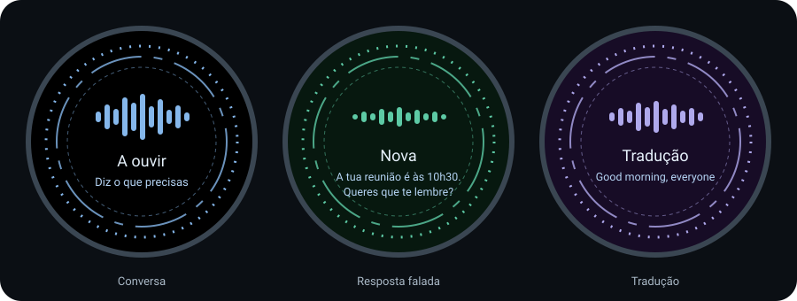
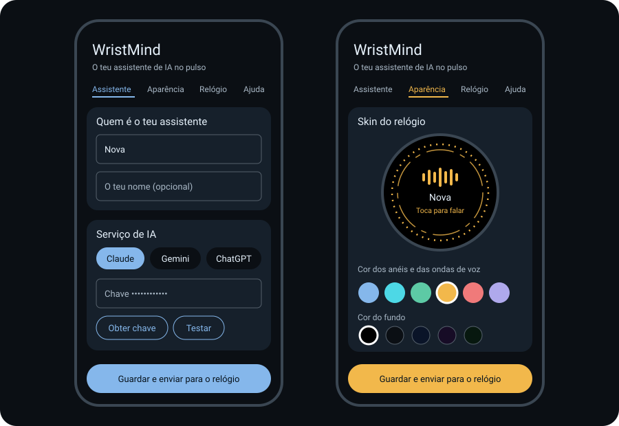

# Orbi

A voice AI assistant for Wear OS watches. Tap the watch, talk, and the answer shows up on screen and is read aloud. All setup happens in a companion app on your Android phone.

Works with Claude, Gemini or ChatGPT using your own API key. The apps are in English and switch to Portuguese automatically when the device language is Portuguese.

The images are layout illustrations, not real screenshots.

## Features

* Voice chat that keeps context, with short answers made for the wrist.
* Spoken translation: say a sentence and the watch speaks it in the language you picked.
* Three services to choose from: Claude (Anthropic), Gemini (Google) and ChatGPT (OpenAI).
* Name the assistant whatever you like.
* Skins: pick the ring colour and the watch background colour.
* Everyone uses their own key. Keys stay on the phone and the watch only.

## Install

Both files are in [Releases](https://github.com/helteixeira/orbi/releases/latest).

1. On the phone, download and install `OrbiPhone.apk`. Android will ask you to allow installs from unknown sources.
2. Open Orbi, pick an AI service, tap **Get a key**, paste the key and tap **Test**.
3. Install `OrbiWatch.apk` on the watch (see below).
4. On the phone tap **Save and send to watch**.

### Installing on the watch

Android does not let a phone app silently install another app on a watch. Until Orbi is on the Play Store, the watch app is installed over wireless debugging:

1. On the watch open Settings, About watch, and tap the build number 7 times.
2. In Developer options turn on ADB debugging and Wireless debugging.
3. Send the APK with a Wear OS installer app from the phone, or from a computer with `adb pair`, `adb connect` and `adb install OrbiWatch.apk`.

The phone and watch apps must come from the same release, because they share a signature.

## Using it

* Tap the screen to talk. Tap during an answer to interrupt and talk again.
* Long press to switch between Chat and Translation.
* By voice: Ok Google, open Orbi.
* By button: in the watch settings assign Orbi to a double press.

## Keys

| Service | Where to create the key |
| --- | --- |
| Claude | console.anthropic.com |
| Gemini | aistudio.google.com, with your Google account |
| ChatGPT | platform.openai.com |

Claude and ChatGPT app subscriptions do not give access to third party apps, so an API key is always needed. Usage is billed by the service you pick, on your own account.

## Status

A personal, experimental project tested on very few devices. Needs Wear OS 3 or later and Android 8 or later. There is no always listening wake word yet, and no meeting recording or summaries.

## Building

Every change on `main` builds both apps with GitHub Actions and publishes the APKs to Releases. To build locally, open the folder in Android Studio.

## Em português

O Orbi é um assistente de IA por voz para relógios Wear OS, configurado a partir de uma app no telemóvel Android. Funciona com Claude, Gemini ou ChatGPT com a tua própria chave. As apps aparecem em português quando o aparelho está em português. Os ficheiros de instalação estão em [Releases](https://github.com/helteixeira/orbi/releases/latest).
